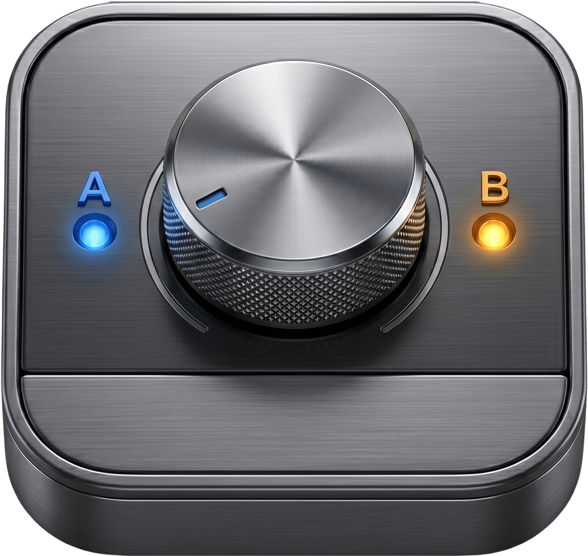
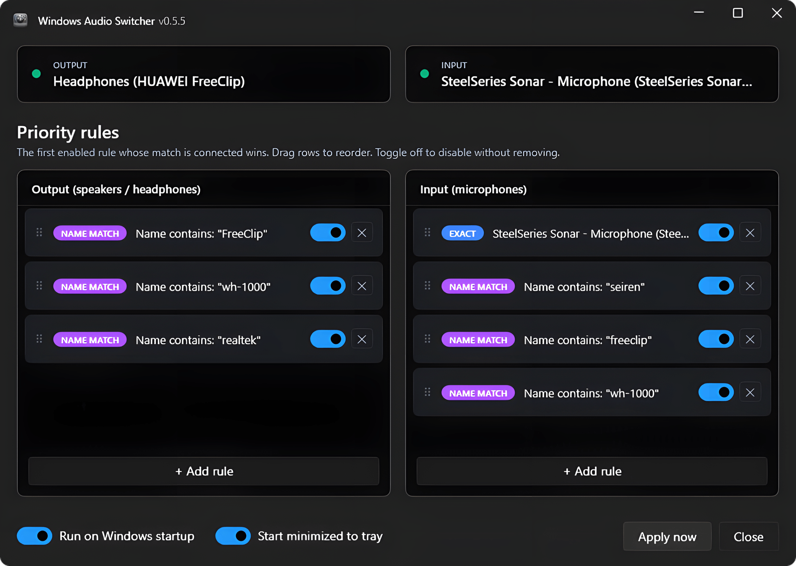

<p align="center">
  
</p>

<h1 align="center">Windows Audio Switcher</h1>

<p align="center">
  <a href="https://ko-fi.com/A0T81ZY16Q"></a>
</p>

> **Built with AI to scratch a personal itch.** Windows has no built-in way to keep your preferred audio device as the default when it disconnects and reconnects — especially Bluetooth headsets. I hit this every day, so I built this tool with AI assistance to solve it.

Automatic default-audio device switcher for Windows. Lives in the system tray and re-selects your preferred output and input devices whenever something connects, disconnects, or Windows changes the default.

<p align="center">
  
</p>

## Features

- **Priority list per direction** — separate priorities for output (speakers/headphones) and input (microphones). The first matching *active* device wins; offline devices are skipped, so fallback rules don't block higher-priority ones.
- **Two rule kinds:**
  - **Exact device** — pin a specific endpoint by its Windows device ID.
  - **Name contains** — e.g., a rule for `Sony` matches any device whose friendly name contains "Sony", so a reconnecting Bluetooth headset is reselected even if Windows assigns it a new endpoint ID.
- **Keeps your choice when several devices match** — a Bluetooth headset often shows up twice (Stereo and Hands-Free), and both contain "Sony". If the current default already satisfies your top rule, it's left alone instead of being flipped to its sibling.
- **Live status per rule** — a dot on each row shows which rule is in use (green), which devices are connected but outranked (grey), and which aren't connected (hollow). Hover it for details.
- **Match preview** — while you type a name rule, the devices it would match are highlighted, with a warning when it matches more than one.
- **Audio roles** — Console and Multimedia always switch together. Communications (Teams, Discord, Zoom) follows too by default; turn that off to keep a separate headset for calls.
- **Pause** — pause automatic switching for 15 minutes, an hour, or until you resume, from the tray menu.
- **Notifications** — a small toast when the default device changes, and an error toast if a switch fails.
- **Tray-resident**, single-instance. Launching it again brings the running window forward.
- **Run on Windows sign-in** — optional, set during install or in the settings window.
- **Dark, light, or match Windows** theme.
- **Keyboard friendly** — select a rule and press **Ctrl+↑ / Ctrl+↓** to reorder; all controls have screen-reader names.
- **Built-in auto-updater** — checks GitHub for new releases at startup and once a day (or on demand from the tray). When one's available, a banner lets you update with a single click: the installer is downloaded, its SHA-256 is verified, it runs silently, and the app relaunches on the new version. No admin prompt.
- **Self-contained installer** — no .NET runtime required on the target machine.

## Install

Grab the latest setup from the [Releases page](https://github.com/mariosemes/WindowsAudioSwitcher/releases) and run it.

- Per-user install to `%LOCALAPPDATA%\Programs\WindowsAudioSwitcher`
- No admin / UAC prompt
- Registers in **Apps & Features** with its own uninstaller
- The installer wizard offers Start-menu shortcut, Desktop shortcut, and "Launch on Windows sign-in" as optional tasks

## Usage

1. Launch from the Start Menu (or it's already running in the tray if you ticked "Launch on sign-in" during install).
2. Click the tray icon, or right-click it → **Settings…**
3. Under **Output** or **Input**, click **+ Add device**. Either pick a device that's connected right now (an **exact** rule), or type part of a name such as `Sony` (a **name match** rule).
4. Drag rows to reorder them, or select one and press **Ctrl+↑ / Ctrl+↓**. Top of the list = highest priority. Use the toggle to switch a rule off without deleting it.

Changes save and apply automatically. The app re-evaluates the rules whenever a device connects or disconnects and whenever Windows changes the default device. **Apply now** in the window, or **Apply rules now** in the tray menu, forces a pass, even while switching is paused.

The tray menu also has **Pause automatic switching**, **Check for updates**, and **Open log folder**.

## Settings location

Your priority list is stored as JSON at:

```
%APPDATA%\WindowsAudioSwitcher\settings.json
```

This file is left in place on uninstall, so reinstalling preserves your rules. Every save keeps the previous version as `settings.json.bak`, which the app falls back to if the main file is ever damaged. Logs are in the `logs` folder next to it and are kept for 14 days.

## Uninstall

Use **Settings → Apps → Installed apps → Windows Audio Switcher → Uninstall**, or run the uninstaller from the install folder.

## Development

Requires the .NET 8 SDK on Windows.

```powershell
dotnet build WindowsAudioSwitcher.sln
dotnet test WindowsAudioSwitcher.sln
```

CI runs the same build and tests on every push to GitHub (`.github/workflows/ci.yml`).

**Running a dev build next to the installed app.** Set `WINDOWSAUDIOSWITCHER_DATA_DIR` to a scratch folder before launching. The dev build then keeps its settings and logs there, uses its own single-instance lock, and never touches the autostart registry entry. The tests use the same switch, so they never read or write your real settings.

```powershell
$env:WINDOWSAUDIOSWITCHER_DATA_DIR = "$env:TEMP\was-dev"
dotnet run --project src\WindowsAudioSwitcher
```

**Releasing.** `build\release.ps1` runs the tests, publishes a self-contained build, compiles the Inno Setup installer, and creates the GitHub release with the installer's SHA-256 in the notes. Use `-Local` to build the installer without tagging or publishing.

**Code signing (optional).** Unsigned installers trigger a SmartScreen "unknown publisher" warning. `release.ps1 -Sign` signs the app, the installer and its uninstaller with [Azure Trusted Signing](https://learn.microsoft.com/azure/trusted-signing/) before hashing. One-time setup:

1. Create a Trusted Signing account and a certificate profile in Azure, and give your Azure identity the *Trusted Signing Certificate Profile Signer* role.
2. Install the signing tools: `winget install Microsoft.WindowsSDK` (for `signtool.exe`) and the Trusted Signing client (`Microsoft.Trusted.Signing.Client` on NuGet) for `Azure.CodeSigning.Dlib.dll`.
3. Write a `metadata.json` with your `Endpoint`, `CodeSigningAccountName` and `CertificateProfileName`.
4. Point the script at them, sign in with `az login`, and release:

```powershell
$env:WAS_SIGNING_DLIB = 'C:\path\to\Azure.CodeSigning.Dlib.dll'
$env:WAS_SIGNING_METADATA = 'C:\path\to\metadata.json'
.\build\release.ps1 -Sign
```

## Got an idea?

Have an idea on how to make the app even better? Found a bug? Want a feature that would make your daily audio juggling less painful? **[Open an issue on GitHub](https://github.com/mariosemes/WindowsAudioSwitcher/issues)** — feedback is welcome and shapes what gets built next.

## License

Licensed under the [**PolyForm Noncommercial License 1.0.0**](LICENSE).

**TL;DR — what you can do:**
- ✅ Download and use the app for free, forever
- ✅ Read, study, and modify the source code
- ✅ Share copies, including modified versions

**What you can't do:**
- ❌ Sell the app, or charge anyone for using it
- ❌ Bundle it into a paid product or paid service
- ❌ Use it (or any part of the code) as the basis of something you make money from

If you'd like to use this commercially, get in touch — separate terms can be arranged.

Copyright © Mario Semes.

---

## Support

If this tool saves you some daily friction and you'd like to say thanks, you can buy me a coffee. Scan the QR or hit the button — either works.

<p align="center">
  <a href="https://ko-fi.com/A0T81ZY16Q"></a>
  <br>
  <a href="https://ko-fi.com/A0T81ZY16Q"></a>
</p>
